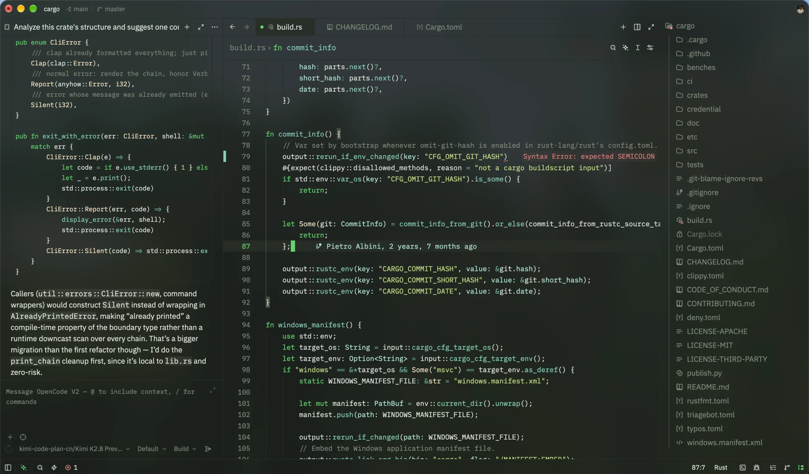

# zed-4rest

4rest Dark: a theme for [Zed](https://zed.dev) ported from my OpenCode TUI theme `forest`.



- Dark green palette built around a Spotify-style accent `#1ed760`
- Three window variants: **4rest Dark** (blurred translucent), **4rest Dark Transparent**, **4rest Dark Opaque**
- Mint functions, olive strings, orange numbers; no purple or teal text
- Full terminal ANSI palette: normal, bright and dim variants

## Install

```
mkdir -p ~/.config/zed/themes
cp themes/4rest.json ~/.config/zed/themes/
```

Restart Zed, open the theme selector (`theme selector: toggle`) and pick **4rest Dark**, **4rest Dark Transparent** or **4rest Dark Opaque**. Edits to an installed theme file reload live; a newly added file needs one restart.

## Palette

Seven color scales (gray, green, cyan, blue, olive, orange, red), nine steps each. Green is the accent, the cyan scale is mint, the purple scale is olive — no purple or teal text anywhere. Alpha suffixes: `dd` for translucent surfaces, `00` for fully transparent editor chrome, `b0` for ignored files.
